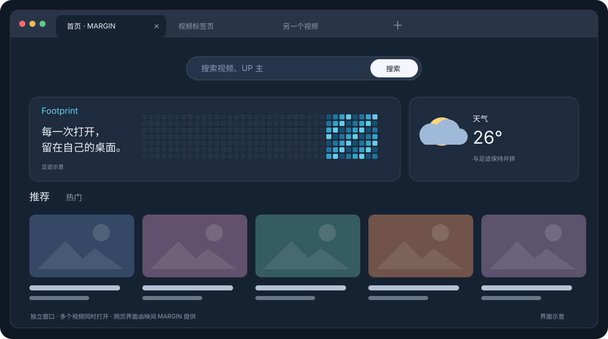
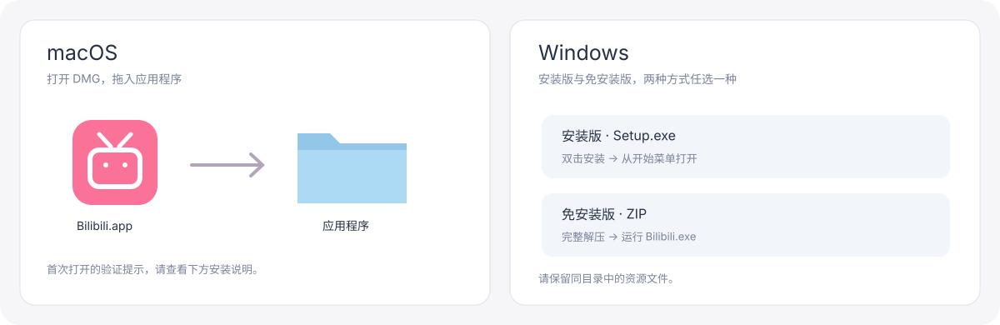

<div align="center">


# Bilibili Desktop

把熟悉的 B 站网页，放进一个独立的桌面窗口。<br>
多标签页 · 内置 MARGIN · macOS 与 Windows

[下载最新版](https://github.com/haodijia/bilibili-desktop/releases/latest) · [安装指南](#下载安装) · [反馈问题](https://github.com/haodijia/bilibili-desktop/issues) · [更新记录](https://github.com/haodijia/bilibili-desktop/releases)

[](https://github.com/haodijia/bilibili-desktop/releases/latest)
[](LICENSE)


</div>

> 非官方客户端。网页界面与增强功能由 [映间 MARGIN](https://github.com/jiuyang5354/bilibili-margin) 提供，感谢 **jiuyang5354** 的开源工作。

## 为什么做这个 App

喜欢 B 站网页的体验，却不想每次打开浏览器、输入网址；希望搜索和视频留在同一个 App 里，也能同时打开多个视频。

Bilibili Desktop 为网页提供独立窗口与标签页。打开即进入 B 站，关闭一个视频也不会关掉其他标签。

## 界面与功能



_界面示意图；实际网页外观由 MARGIN 版本、主题设置与 B 站页面决定。_

| 功能        | 使用体验                                                                    |
| ----------- | --------------------------------------------------------------------------- |
| 独立启动    | 放进 Dock 或开始菜单，点击即可打开 B 站                                     |
| 多标签页    | 搜索结果、视频及网页新页面在 App 内打开，支持后台标签页和快捷切换           |
| 简洁顶部    | 只保留标签栏，导航与插件设置放在“浏览”菜单                                  |
| 内置 MARGIN | 首次安装无需另下扩展，初始内置 0.41.0；网页排版、主题、背景等由 MARGIN 提供 |
| 小屏幕适配  | 窗口较窄时自动缩小网页，按至少 1920 像素宽度排版，足迹与天气保持并排        |
| 本机数据    | 标签页共享登录状态；登录、扩展设置与足迹保存在 App 自己的数据目录           |

## 下载安装

前往 **[GitHub Releases](https://github.com/haodijia/bilibili-desktop/releases/latest)** 下载。当前提供以下版本：

| 系统    | 架构                    | 推荐文件                                | 系统要求            |
| ------- | ----------------------- | --------------------------------------- | ------------------- |
| macOS   | Apple Silicon（M 系列） | `Bilibili-版本号-macOS-arm64.dmg`       | macOS 13 及以上     |
| macOS   | Intel                   | `Bilibili-版本号-macOS-x64.dmg`         | macOS 13 及以上     |
| Windows | x64                     | `Bilibili-版本号-Windows-x64-Setup.exe` | Windows 10 / 11 x64 |
| Windows | x64，免安装             | `Bilibili-版本号-Windows-x64.zip`       | Windows 10 / 11 x64 |

不确定 Mac 架构时，打开“ → 关于本机”：显示 Apple M 系列芯片选 `arm64`，显示 Intel 处理器选 `x64`。macOS Release 中的 ZIP 与 DMG 包含相同的 App。



### macOS 安装

1. 下载对应架构的 DMG，双击打开。
2. 将 `Bilibili.app` 拖入“应用程序”，再推出磁盘映像。
3. 从“应用程序”启动 Bilibili，需要时将它保留在 Dock。

**当前版本没有 Developer ID 身份签名，也没有经过 Apple 公证。** 安装包使用 ad-hoc 签名保持打包后的代码完整性，但它不能验证开发者身份。首次打开可能显示“Apple 无法验证”或“无法验证开发者”。在确认文件来自本仓库、校验值一致且你信任该软件后：

1. 先尝试从“应用程序”打开一次。
2. 打开“系统设置 → 隐私与安全性”，找到关于 Bilibili 的拦截提示。
3. 如果系统提供“仍要打开 / Open Anyway”，按提示确认，然后重新启动。

不同 macOS 版本或设备管理策略可能不提供此选项；若提示软件会损坏电脑或包含恶意软件，请停止打开并反馈。详细说明见 [Apple：安全地打开 Mac 上的 App](https://support.apple.com/102445)。

### Windows 安装

**安装版：** 双击 `…-Setup.exe`，等待安装完成，从开始菜单打开 Bilibili。安装过程会创建快捷方式。

**免安装版：** 将 ZIP **完整解压**到固定文件夹，再运行其中的 `Bilibili.exe`。不要只从压缩包里拖出 EXE，也不要只移动 EXE 而遗漏旁边的资源文件。

当前版本没有 Authenticode 代码签名，首次运行可能被 SmartScreen 标记为未知发布者。确认下载来源和校验值、并信任该软件后，可在系统提供的提示中选择“更多信息 → 仍要运行”。如果设备策略不允许或安全软件报告恶意软件，请停止运行并反馈。说明见 [Microsoft：SmartScreen 与应用信誉](https://learn.microsoft.com/windows/apps/package-and-deploy/smartscreen-reputation)。

### 校验下载文件

每个 Release 附带 `SHA256SUMS.txt`。在下载目录执行以下命令，将输出与文件中对应的一行比较：

```sh
# macOS：替换成实际下载的文件名
shasum -a 256 Bilibili-1.1.1-macOS-arm64.dmg
```

```powershell
# Windows PowerShell
Get-FileHash .\Bilibili-1.1.1-Windows-x64-Setup.exe -Algorithm SHA256
```

## MARGIN 设置与更新

- **设置：** 菜单“浏览 → MARGIN 设置”；更多网页外观选项也可在 MARGIN 页面内调整。
- **自动检查：** 仅在 App 启动时检查一次，运行期间不定时检查。
- **手动检查：** 菜单“浏览 → 检查 MARGIN 更新”。
- **安装更新：** 新版弹窗中选择“更新并重新加载”，App 自动下载、校验、安装，然后刷新所有标签页。正在播放的视频会中断，可选择“稍后”，下次启动或手动检查时再更新。

扩展更新保留设置和足迹，不用重新安装整个 App。Bilibili Desktop **程序自身**的更新仍需从 Release 下载新版；本功能更新的是 MARGIN。

## 快捷键

| 操作                       | macOS            | Windows                   |
| -------------------------- | ---------------- | ------------------------- |
| 新建 / 关闭标签页          | ⌘T / ⌘W          | Ctrl+T / Ctrl+W           |
| 刷新 / 强制刷新            | ⌘R / ⌘⇧R         | Ctrl+R / Ctrl+Shift+R     |
| 后退 / 前进                | ⌘[ / ⌘]          | Ctrl+[ / Ctrl+]           |
| 下一个 / 上一个标签页      | ⌃Tab / ⌃⇧Tab     | Ctrl+Tab / Ctrl+Shift+Tab |
| 第 1–8 个 / 最后一个标签页 | ⌘1–8 / ⌘9        | Ctrl+1–8 / Ctrl+9         |
| 后台打开链接               | ⌘点击 / 鼠标中键 | Ctrl+点击 / 鼠标中键      |
| 恢复自动适配               | ⌘0               | Ctrl+0                    |

## 常见问题

**需要另外下载 MARGIN 吗？** 不需要，App 内置扩展，首次启动就会加载。

**为什么要重新登录？** App 的数据目录独立于 Chrome，不会自动导入 Chrome 的账号、插件设置或足迹。

**小屏幕上文字怎么比较小？** 为保持桌面排版，窄窗口会等比缩小网页。可以拉宽窗口，或在“浏览”菜单调整缩放；恢复默认适配使用 ⌘0 / Ctrl+0。

**它和 Chrome 完全一样吗？** 网页由 Electron 的 Chromium 内核加载，但这不是完整的 Chrome 浏览器，不包含 Chrome 账号同步和通用扩展管理。

**数据会发送到哪里？** 登录状态、设置与足迹保存在本机；网页访问 B 站服务，扩展更新检查访问 GitHub。MARGIN 天气功能会访问 ipwho.is 与 Open-Meteo。详情见 [MARGIN 隐私说明](https://github.com/jiuyang5354/bilibili-margin/blob/main/PRIVACY.md)。

## 从源码构建

使用 Node.js 22 与 npm：

```sh
npm ci
npm start
```

```sh
npm run typecheck
npm run lint
npm run make -- --arch=arm64  # 在 macOS 构建 Apple Silicon 包
npm run make -- --arch=x64    # 在 macOS 构建 Intel 包，或在 Windows 构建 x64 包
```

macOS 的 DMG 必须在 macOS 构建；Windows 的安装程序在 Windows 构建。完整矩阵见 [Release 工作流](.github/workflows/release.yml)。构建结果位于 `out/make/`。维护者可在 GitHub Actions 中手动运行 **Build and release**，全部平台构建成功后发布对应 `package.json` 版本的 Release。

## 致谢与许可

感谢 [jiuyang5354 / 映间 MARGIN](https://github.com/jiuyang5354/bilibili-margin) 提供网页设计、主题、足迹和其他网页增强功能，也感谢 [Electron](https://www.electronjs.org/)、Chromium、Node.js 与字体作者。

本项目自行编写的桌面端代码采用 [MIT](LICENSE)。MARGIN 的 MIT 许可证、第三方字体授权与设计署名分别保留，详见 **[第三方声明与致谢](THIRD_PARTY_NOTICES.md)**。

本项目是独立开发的**非官方**客户端，与哔哩哔哩及 MARGIN 作者无官方隶属、合作或背书关系。网站内容与商标归各自权利人所有。图标与界面示意图为本项目绘制的矢量图。
